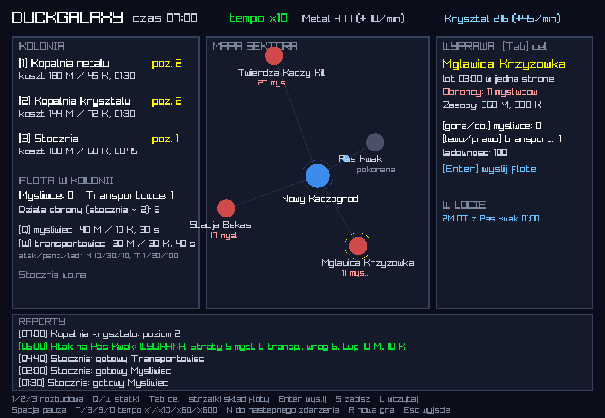
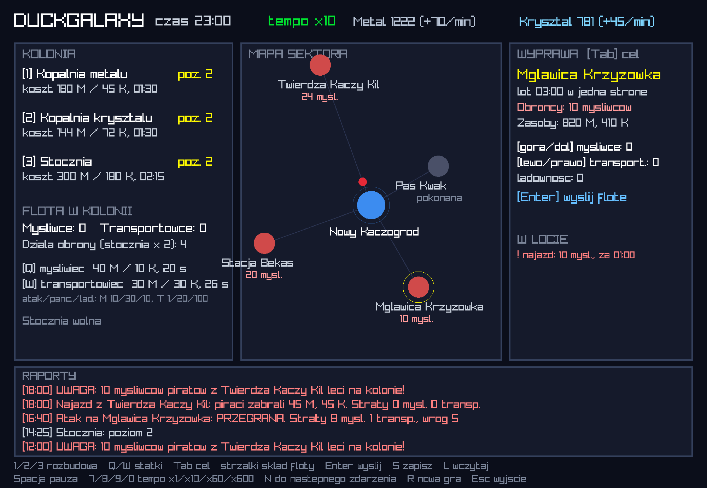

# DuckGalaxy w Ducklingu

Kosmiczna gra strategiczna w czasie rzeczywistym (temat P04 konkursu DuckQuest), napisana w Ducklingu. Rozbudowujesz kolonię Nowy Kaczogród, budujesz flotę, wysyłasz wyprawy na cztery bazy piratów i bronisz się przed ich najazdami. Wygrywasz, gdy pokonasz wszystkie bazy.

Okno, klawiatura i rysowanie pochodzą z pakietu `grafika` (raylib 5.5) z [duckling-biblioteki](https://github.com/andr729/duckling-biblioteki). Cała logika gry jest w osobnym pakiecie bez okna, więc można ją testować i przewijać czas o godziny w ułamku sekundy.





## Sterowanie

| Klawisz | Działanie |
|---|---|
| 1 / 2 / 3 | rozbudowa: kopalnia metalu / kopalnia kryształu / stocznia |
| Q / W | zamów myśliwiec / transportowiec |
| Tab | następna baza piratów jako cel wyprawy |
| ↑ ↓ | liczba myśliwców w wyprawie |
| → ← | liczba transportowców w wyprawie |
| Enter | wyślij flotę |
| spacja | pauza |
| 7 / 8 / 9 / 0 | tempo ×1 / ×10 / ×60 / ×600 |
| N | przeskok do najbliższego zdarzenia |
| S / L | zapis / odczyt (`duckgalaxy-zapis.txt` w bieżącym katalogu) |
| R | nowa gra |
| Esc albo zamknięcie okna | wyjście |

## Zasady

**Start:** 300 metalu, 150 kryształu, 3 myśliwce, wszystkie budynki na poziomie 1.

**Zasoby:** kopalnie produkują na minutę gry metal 10 + 30 × poziom i kryształ 5 + 20 × poziom. Zasoby są całkowite, a reszta z dzielenia przechodzi dalej, więc przy żadnym tempie nic nie ginie.

**Rozbudowa:** naraz trwa jedna. Koszt i czas rosną jak liczba trójkątna L(L+1)/2 obecnego poziomu L:

| Budynek | Koszt na poziomie 1 | Czas na poziomie 1 |
|---|---|---|
| kopalnia metalu | 60 M, 15 K | 30 s |
| kopalnia kryształu | 48 M, 24 K | 30 s |
| stocznia | 100 M, 60 K | 45 s |

**Statki** powstają po kolei w stoczni. Czas budowy mnoży się przez 2 / (poziom stoczni + 1), więc wyższa stocznia buduje szybciej.

| Statek | Koszt | Czas (stocznia 1) | Atak | Pancerz | Ładowność |
|---|---|---|---|---|---|
| myśliwiec | 40 M, 10 K | 30 s | 10 | 30 | 10 |
| transportowiec | 30 M, 30 K | 40 s | 1 | 20 | 100 |

Kolonię bronią też **działa** stoczni: 2 na poziom (atak 8, pancerz 40). Działa się nie zużywają; po każdej walce są znowu w komplecie.

**Ważne reguły:**
* koszt budynku albo statku pobierany jest w chwili zlecenia, a nie po zakończeniu;
* flota na wyprawie nie broni kolonii. Statki są niedostępne od wylotu aż do powrotu;
* łup trafia do kolonii dopiero, gdy flota wróci.

**Bazy piratów** (czas lotu w jedną stronę, myśliwce na starcie / limit):

| Baza | Lot | Myśliwce |
|---|---|---|
| Pas Kwak | 2:00 | 4 / 6 |
| Mgławica Krzyżówka | 3:00 | 8 / 12 |
| Stacja Bekas | 4:00 | 14 / 20 |
| Twierdza Kaczy Kił | 6:00 | 24 / 35 |

**Piraci** (przeciwnik sterowany przez program) co 2 minuty gry:
* każda niepokonana baza odbudowuje 1 myśliwca (do limitu) i trochę zasobów;
* co 6 minut, nie wcześniej niż w 12. minucie, najsilniejsza baza wysyła najazd z 1/3 swoich myśliwców. Robi to tylko wtedy, gdy ma co najmniej 4 myśliwce i więcej niż połowę siły obrony kolonii (myśliwce w kolonii + działa);
* kolonia z mocną obroną nie jest atakowana.

**Walka** toczy się sama, bez decyzji gracza, najwyżej 6 rund:
* w każdej rundzie obie strony strzelają jednocześnie: siła ognia × losowy mnożnik 80–120%;
* obrażenia dzielą się między rodzaje jednostek proporcjonalnie do ich liczby, a nadwyżka ponad pancerz przechodzi do następnej rundy;
* atakujący wygrywa, gdy obrońca nie ma już jednostek. Bez rozstrzygnięcia po 6 rundach atakujący się wycofuje bez łupu;
* wygrana wyprawa zabiera do 50% zasobów bazy (ile zmieszczą ładownie ocalałych statków, po połowie metal i kryształ), a baza jest pokonana;
* wygrany najazd zabiera do 25% zasobów kolonii.

Generator losowy (xorshift64*) ma ziarno zapisywane razem ze stanem, więc ta sama gra rozgrywa się zawsze tak samo.

## Jak działa czas

Czas gry liczony jest w całych sekundach. Wszystko, co ma się wydarzyć, czeka w **kolejce zdarzeń**:
* koniec budowy;
* gotowy statek;
* dotarcie i powrót floty;
* ruch piratów;
* dotarcie najazdu.

Każde zdarzenie ma czas i numer kolejny. Zdarzenia z tym samym czasem obsługiwane są w kolejności dodania. `przewin(g, sekundy)` obsługuje po kolei wszystkie zdarzenia z przedziału, a produkcję do każdego z nich liczy według poziomów kopalń sprzed zdarzenia. Dzięki temu wynik nie zależy od tempa ani od liczby klatek: 10 minut przy ×600 daje dokładnie ten sam stan co 10 minut przy ×1.

## Zapis gry

Zapis to zwykły plik tekstowy, w każdym wierszu etykieta i liczby:

```
duckgalaxy-zapis-wersja 1
czas-metal-krysztal-reszty 1380 1222 781 0 0
budynki-budowa-koniec 2 2 2 -1 0
statki-kolejka ...
los-numery-piraci ...
baza 0 6 150 75 1
...
floty 1
flota ...
zdarzenia 3
zdarzenie ...
raporty 12
raport ...
```

Odczyt bierze same liczby w ustalonej kolejności; etykiety są dla człowieka. Zapisane są wszystkie zdarzenia z kolejki, floty w locie, raporty i ziarno losowania. Po wczytaniu gra toczy się więc dokładnie tak, jak toczyłaby się bez zapisu: testy porównują 1000 s gry po wczytaniu z grą bez przerwy. Ucięty albo uszkodzony plik jest odrzucany z komunikatem, bez awarii.

## Uruchomienie (macOS)

```sh
./uruchom.sh          # pierwszy raz przygotowuje raylib i grafikę (~1 min), potem buduje i uruchamia grę
./uruchom.sh testy    # testy logiki, bez okna
```

Wymagania:
* Duckling z `duck` w PATH (sprawdzone na `duckc 0.3-alpha (83882805a 2026-11-20)`, macOS 27.2, Apple Silicon);
* Xcode Command Line Tools (git, make, clang);
* duckling-biblioteki, gałąź `paczki-duck`, domyślnie w `~/duckling-biblioteki` (inna ścieżka: `./przygotuj_macos.sh /ścieżka`).

Okno potrzebuje aktywnego ekranu. Jeśli program startuje przez SSH albo skrypt, gdy ekran Maca śpi lub jest zablokowany, raylib nie dostaje kontekstu OpenGL i `InitWindow` kończy się błędem segmentacji w `rlLoadTexture`. Pomaga wybudzenie ekranu na czas działania programu:

```sh
caffeinate -u -d -t 60 & sleep 2; ./uruchom.sh
```

## Struktura

```
logika/   pakiet duckgalaxy_logika: ekonomia, kolejka zdarzeń, floty, piraci, walka, zapis i odczyt
gra/      pakiet duckgalaxy_gra: okno, klawiatura, panele kolonii, mapy, wyprawy i raportów
testy/    pakiet testy_duckgalaxy: 49 sprawdzeń bez okna, kod wyjścia = liczba błędów
zrzuty/   obrazy do README: w katalogu projektu uruchom DUCKGALAXY_ZRZUTY=1 ./gra/.duck_build/dev/duckgalaxy_gra
przygotuj_macos.sh   raylib 5.5 i kopia pakietu grafika dla macOS do zewnetrzne/ (poza gitem)
```

Testy sprawdzają między innymi:
* produkcję z resztą i równość wyników przy przewijaniu małymi i dużymi krokami;
* pobranie kosztu przy zleceniu, jedną rozbudowę naraz, zmianę produkcji dokładnie w chwili końca budowy i kolejkę statków;
* niedostępność floty w kolonii podczas wyprawy i łup, który trafia do kolonii dopiero po powrocie;
* walkę, łup w granicach ładowni, przegraną pojedynczego myśliwca z twierdzą i brak drugiego ataku na pokonaną bazę;
* odbudowę piratów, pierwszy najazd w 12. minucie, siłę najazdu i spokój silnej kolonii;
* kolejność zdarzeń o tym samym czasie;
* zapis i odczyt: zapis w trakcie budowy, wyprawy i drogi powrotnej, misję rozliczoną dokładnie raz, uszkodzony i brakujący plik;
* wygraną po pokonaniu wszystkich baz.

## Pułapki Ducklinga, na które trafiłem

* `let x = lista.at(i)` daje alias elementu, a nie kopię; do kopii potrzebne jest `var x: T = lista.at(i)`;
* nazwa parametru, która zgadza się z nazwą funkcji w module (np. `pojemnosc`), albo powtórzona nazwa w zagnieżdżonych blokach daje błąd niejednoznaczności;
* nie ma `break` ani `continue`; pętle kończą się warunkiem;
* `restart` jest słowem kluczowym;
* `duck` trzyma jedno środowisko (venv) na nazwę pakietu. Druga kopia projektu na tym samym komputerze kończy się błędem „would overwrite the venv”: zmień w niej `name` w `quackconfig.yaml` albo dodaj `--overwrite`.

## Licencja

MIT. Kopia pakietu `grafika` w `zewnetrzne/` pochodzi z duckling-biblioteki (MIT), a raylib ma licencję zlib.
